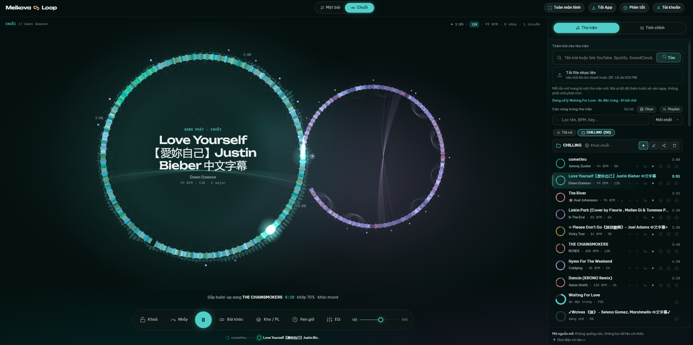

# Mash ∞ Loop

Bài hay thường hết quá sớm. Cái này sửa lỗi đó.

Mash ∞ Loop tải nhạc từ YouTube về máy, nghe kỹ từng beat, rồi phát mãi không
dứt. Trong một bài, nó nhảy qua lại giữa những đoạn giống nhau đến mức bạn không
biết mình đang ở lần lặp thứ mấy. Khi đã ở đủ lâu, nó tìm chỗ nối sang bài khác:
khớp nhịp nếu được, khớp mood nếu không, và cố gắng không làm bạn giật mình.



Mỗi bài là một vòng của dấu ∞. Chỗ hai vòng chạm nhau là chỗ mix. Tên app, logo và
màn hình chính là cùng một hình vẽ, chuyện này có chủ ý.

## Nó làm gì

- **Lặp một bài mãi mãi**, kiểu [Infinite Jukebox](https://musicmachinery.com/2012/11/12/the-infinite-jukebox/)
  ngày xưa, nhưng tự phân tích audio thay vì xin dữ liệu của Spotify (cửa đó đóng
  từ cuối 2024 rồi).
- **Nối cả thư viện thành một chuỗi**: ở mỗi bài một lúc, rồi đi tới điểm nối tốt
  gần nhất sang bài khác.
- **Biết ai đang hát**: không nhảy từ giọng nam sang giọng nữ giữa câu, không cắt
  ngang một câu hát khi hai câu có lời khác nhau.
- **Biết mood**: chuỗi đi dần từ funk sang disco sang pop, chứ không nhảy thẳng từ
  một bài dance vào một bản ballad piano.

## Các kiểu nối bài

| Kiểu | Khi nào | Nghe ra sao |
|---|---|---|
| Nối thẳng | Hai đoạn nghe gần như y hệt nhau | Không nhận ra là đã đổi bài |
| Drop | Cùng groove, cùng cường độ, cùng mood | Bài mới vào đúng phách đầu câu nhạc |
| Blend | Nhịp khớp được (lệch tới ~12 %, kể cả nhịp đôi 70 ↔ 140) | Mix kiểu DJ, khóa nhịp từng beat, đổi bass ở giữa |
| Crossfade dài | Hai bài khác mood | 5 đến 11 giây, lọc âm: bài cũ tối dần, bài mới sáng dần |
| Echo | Cuối một câu hát | Bài cũ tan thành tiếng vọng của chính nó |
| Phanh đĩa, cuộn nhịp | Khi bạn muốn | Đột ngột. Tắt sẵn, bật trong *Tinh chỉnh* nếu thích kịch tính |

Khi hai bài lệch tempo, bài đang phát tăng hoặc giảm tốc dần trong 16 beat trước
điểm nối, bài sau vào cùng tốc độ rồi trượt về tốc độ gốc. Đổi tốc độ kiểu đĩa than
nên giọng ca sĩ cũng bổng hoặc trầm theo một chút. Độ hợp key được chấm theo đúng cao
độ sau khi đổi.

## Cài đặt

Đã chạy trên Windows 11 với Python 3.13 và một card NVIDIA. Không có GPU vẫn chạy
được, chỉ là mỗi bài phân tích lâu hơn.

Cần sẵn: Python 3.11 trở lên, [ffmpeg](https://ffmpeg.org/) trong `PATH`, và
[Node.js](https://nodejs.org/) (yt-dlp dùng nó để giải mã trình phát của YouTube).

```powershell
python -m venv .venv
.venv\Scripts\pip install torch==2.6.0 torchaudio==2.6.0 --index-url https://download.pytorch.org/whl/cu124
.venv\Scripts\pip install --no-deps beat-this demucs
.venv\Scripts\pip install -r requirements.txt
```

Lần phân tích đầu tiên sẽ tải model Beat This! và Demucs (khoảng 160 MB).

## Chạy

```powershell
.\run.ps1          # mở http://127.0.0.1:8765, tự tắt server cũ nếu còn chạy
```

Chưa thử trên macOS hay Linux; lệnh tương đương là `python -m loopbox.server --open`.

Gõ tên bài hoặc dán link video / playlist YouTube vào ô *Thêm bài*. Mỗi bài mất
chừng 15 đến 25 giây để tải và phân tích, xong là tự nối vào thư viện. Bấm phát.

- **Một bài**: lặp mãi bài đang chọn.
- **Chuỗi**: đi qua cả thư viện.
- `Space` phát / dừng, `J` nhảy ngay, `N` sang bài khác.
- Rê chuột lên một chấm bên ngoài vòng để xem nó dẫn tới bài nào, bấm để tự chọn
  điểm chuyển.

Dòng lệnh, nếu bạn thích:

```powershell
.venv\Scripts\python -m loopbox.cli add "Daft Punk Get Lucky audio" "https://www.youtube.com/playlist?list=..."
.venv\Scripts\python -m loopbox.cli list
.venv\Scripts\python -m loopbox.cli rejump     # tính lại điểm nhảy từ dữ liệu đã lưu
.venv\Scripts\python -m loopbox.cli relink     # tính lại điểm nối giữa các bài
```

## Bên trong

Mỗi bài đi qua một dây chuyền nhỏ (`loopbox/analysis/`):

1. **Beat This!** dò beat và downbeat. Model trả về theo lưới 20 ms; một bước tinh
   chỉnh kéo từng beat về đúng đỉnh onset, còn lệch khoảng 0.7 ms.
2. **Demucs** tách trống, bass, giọng hát và phần còn lại.
3. Mỗi beat được mô tả bằng hòa âm (lấy từ phần không có trống), âm sắc, độ lớn,
   nhịp điệu bên trong beat, mức của từng stem, và giọng hát: cao độ cùng âm sắc của
   riêng stem vocal.
4. Key đoán bằng profile Albrecht-Shanahan trên stem hòa âm và bass (đúng 10/11 bài
   thử). Đoạn và câu nhạc tìm từ ma trận tự tương đồng.
5. Điểm nhảy là cặp beat mà cả cửa sổ 8 beat quanh chúng khớp nhau, cùng vị trí
   trong câu nhạc 4 ô nhịp, có crossfade riêng cho từng chỗ (12 ms nếu trống chắc,
   tới 60 ms nếu là nốt ngân). Đoạn cuối bài được nối cầu để không thành cái bẫy.

Phần phát (`web/js/`) là Web Audio API thuần, lên lịch trước 0.6 giây và chính xác
tới từng mẫu. Đường tới điểm chuyển bài được tìm bằng Dijkstra trên đồ thị nhảy.
Không framework, không build step.

## Kiểm tra

Vì không ai ngồi nghe 3 tiếng liền để test được, nên có mấy công cụ làm việc đó:

```powershell
node tools\sim_player.mjs 180 chain                 # mô phỏng 3 giờ phát trong vài giây
.venv\Scripts\python tools\e2e_test.py 240          # chạy UI thật trong Chrome, ghi âm output ra WAV
.venv\Scripts\python tools\eval_splices.py          # điểm nhảy khác bản gốc bao nhiêu
.venv\Scripts\python tools\eval_voice.py            # nhảy đổi ca sĩ, cắt giữa câu, giữ câu nhạc
.venv\Scripts\python tools\link_report.py           # thư viện được nối với nhau tốt cỡ nào
```

Trên thư viện thử 14 bài: 99 % số cặp bài có một cách nối êm, mỗi lần đổi bài mood
lệch ít hơn khoảng 35 % so với chọn bừa, và 4 phút phát thật trong Chrome không rớt
tiếng nào.

## Nói thật

- Đây là app chạy local cho một người. Server chỉ nghe trên `127.0.0.1`.
- Chưa có keylock: muốn khớp key mà không đổi nhịp thì cần một engine time-stretch.
- Các con số ở trên là đo bằng máy. Tai người vẫn là trọng tài cuối cùng.
- Chọn bản "audio" trên YouTube sẽ tốt hơn bản MV có đoạn mở đầu dài.

## Bản quyền

Repo này không chứa bất kỳ file nhạc nào. Nhạc bạn tải về nằm trong `data/` trên máy
bạn và không đi đâu cả. Dùng cho mục đích cá nhân, tôn trọng điều khoản của YouTube
và quyền của nghệ sĩ.

## Cảm ơn

[The Infinite Jukebox](https://musicmachinery.com/2012/11/12/the-infinite-jukebox/) của
Paul Lamere và [Eternal Jukebox](https://github.com/EternalBox/EternalJukebox) đã nghĩ ra
trò này trước. Phần nặng nhất là của [Beat This!](https://github.com/CPJKU/beat_this),
[Demucs](https://github.com/facebookresearch/demucs), [librosa](https://librosa.org/) và
[yt-dlp](https://github.com/yt-dlp/yt-dlp).

## License

[MIT](LICENSE). Áp dụng cho code trong repo này; nhạc bạn tải về vẫn thuộc về người
làm ra nó.

## English, briefly

A local, endless jukebox. It downloads songs from YouTube, analyses beats, stems and
singers on your machine, loops each song through its own seamless jump points, and
mixes the library into one continuous set: beat-matched blends with tempo bending,
long filtered crossfades between different moods, and a chain that drifts from style
to style. The UI is in Vietnamese; the code and its comments are in English.
